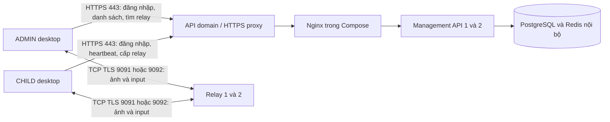

# Từ local đến VM server/VPS: cấu hình của RemoteAccess

## 1. Những gì đã có và kết quả review

Dự án đã tách địa chỉ khỏi mã kết nối: Compose nhận biến từ `.env`, client nhận `REMOTE_API_URL`, còn chế độ `dynamic` lấy địa chỉ relay từ API. Không cần sửa C++/Java mỗi lần đổi IP server. Hai API dùng chung PostgreSQL, Redis và JWT secret; hai relay chạy TCP độc lập. Các luồng này đã được nghiệm thu host–VM, gồm TLS relay và mất node. Chưa có nghiệm thu trên VPS Internet thực tế.

Các điểm cần hiểu trước khi triển khai:

- Compose VPS chỉ công khai API qua proxy HTTPS và các cổng relay; PostgreSQL/Redis không publish ra ngoài.
- HTTPS của API và TLS của relay là hai cấu hình riêng. Bật HTTPS không tự mã hóa ảnh/chuột/phím trên relay.
- Sau đợt đơn giản hóa UX, địa chỉ API được cấu hình bằng `REMOTE_API_URL`; giao diện người dùng không còn mục đổi server. Giá trị `server/apiUrl` từng lưu ở phiên bản cũ được bỏ qua.
- Qt desktop không tự đọc một file `.env`. Phải đặt biến vào môi trường tiến trình trước khi mở app.
- Compose hiện là all-in-one: chuyển cả stack lên một Linux VM/VPS là đường đơn giản nhất. Trỏ DB ra ngoài vẫn khởi động DB/Redis nội bộ nếu không có override riêng.
- Hibernate đang `ddl-auto: update`; đây chưa phải cơ chế migration production được quản lý. Redis hiện chưa cấu hình mật khẩu/TLS cho managed Redis. Hai API/relay chung một VPS không chống được sự cố mất cả VPS.

## 2. Local khác server ở địa chỉ nào?



Cả ADMIN và CHILD chủ động kết nối ra server; bình thường không cần mở cổng/router trên máy người dùng. Server cần IP/DNS có thể truy cập và cổng inbound phù hợp. Nếu VM server cũng nằm sau router NAT, cần port forwarding hoặc đường mạng khác tới nó; chỉ cài Linux VM chưa tạo ra một server Internet.

| Nơi dùng địa chỉ | Thử local hiện tại | Một VPS ví dụ |
|---|---|---|
| API mà Windows VM gọi | `http://10.0.2.2:9090` | `https://api.example.com` |
| API mà ADMIN máy thật gọi | `http://localhost:9090` | `https://api.example.com` |
| Relay client gọi | static: `10.0.2.2:8080` hoặc `localhost:8080` | dynamic: API trả `relay.example.com:9091` hoặc `:9092` |
| PostgreSQL từ API container | Không dùng localhost máy client | `postgres:5432` trong Docker network |
| Relay gọi API nội bộ | Java local: `localhost:9090` | `http://nginx:9090` trong Docker network |

`localhost` luôn là chính máy/container đang chạy tiến trình đó. `10.0.2.2` là địa chỉ đặc biệt của host trong NAT VirtualBox, không phải địa chỉ VPS. `relay.example.com` là ví dụ cần thay bằng tên miền thật.

Client mặc định yêu cầu HTTPS cho API và TLS cho relay ngoài loopback. Khi thử HTTP/TCP trong mạng VM cô lập, đặt `REMOTE_ALLOW_HTTP=1` và `REMOTE_RELAY_TLS=off` trong tiến trình Qt. Compose mặc định chỉ mở cổng trên loopback. Nếu VM đi qua card mạng riêng, đặt `MANAGEMENT_PUBLIC_BIND` và `RELAY_PUBLIC_BIND` thành IP của card đó. Khi nạp overlay TLS, hai relay mặc định lắng nghe trên mọi card của host và xác thực bằng chứng chỉ.

## 3. `.env` hoạt động thế nào trong dự án?

Trên server, Compose đọc file bạn chọn bằng `--env-file`, thay `${TEN_BIEN}` trong YAML, rồi mục `environment:` chuyển giá trị vào container:

```text
infrastructure/.env
  DATABASE_JDBC_URL=jdbc:postgresql://postgres:5432/remote_db
          ↓ Compose nội suy
infrastructure/docker-compose.yml
  SPRING_DATASOURCE_URL: ${DATABASE_JDBC_URL:?...}
          ↓ môi trường container
Spring Boot kết nối PostgreSQL
```

Sau khi sửa `.env`, chạy lại đúng lệnh `docker compose ... up -d` với các file đã chọn để Compose cập nhật/recreate container bị đổi. Chỉ chạy `docker compose restart` không nạp lại biến môi trường mới.

`.env` không tự trở thành môi trường cho mọi chương trình trên máy. Java chạy trực tiếp qua IDE cần môi trường riêng; Qt chạy trên Windows cũng cần môi trường riêng. Biến đã export trong shell có thể ghi đè giá trị `.env`; dùng một terminal sạch nếu kết quả không giống file. Không chia sẻ kết quả `docker compose config` đầy đủ vì có thể chứa secrets; dùng `config --quiet` để kiểm tra cú pháp.

| Biến server | Ý nghĩa | Có đưa vào desktop không? |
|---|---|---|
| `JWT_SECRET` | Khóa ký JWT; giống nhau trên hai API | Không |
| `RELAY_NODE_TOKEN` | Xác thực relay với dịch vụ quản lý | Không |
| `POSTGRES_PASSWORD` | Mật khẩu DB | Không |
| `DATABASE_JDBC_URL` | Địa chỉ DB từ API | Không |
| `RELAY_1/2_ADVERTISED_HOST` | Địa chỉ API trả cho các client để kết nối relay | Client nhận qua API |
| `RELAY_1/2_PUBLIC_PORT` | Cổng ngoài VPS, được map tới TCP 8080 trong từng relay container | Client nhận qua API |
| `MANAGEMENT_PUBLIC_BIND/PORT` | Điểm host công khai cổng HTTP của Nginx nội bộ | Không phải URL HTTPS của desktop |
| `RELAY_MANAGEMENT_URL` | Relay gọi API nội bộ | Không |
| `API_UPSTREAM_1/2` | Nginx tìm hai API trong mạng nội bộ | Không |

## 4. Cấu hình một Linux VPS

Cần Docker Engine cùng Compose plugin, mã nguồn dự án, DNS trỏ về VPS và chứng chỉ hợp lệ. Các lệnh sau chạy từ thư mục gốc repo trên VPS; không chạy `server/run-management-api-local.sh` để triển khai production vì script đó dành riêng cho DB local.

```sh
cp infrastructure/.env.vps.example infrastructure/.env
chmod 600 infrastructure/.env
openssl rand -hex 32
openssl rand -hex 32
openssl rand -hex 32
```

Điền ba kết quả độc lập lần lượt vào `JWT_SECRET`, `RELAY_NODE_TOKEN`, `POSTGRES_PASSWORD`. Không commit file đã điền. Đặt các giá trị công khai:

```dotenv
RELAY_1_ADVERTISED_HOST=relay.example.com
RELAY_2_ADVERTISED_HOST=relay.example.com
RELAY_1_PUBLIC_PORT=9091
RELAY_2_PUBLIC_PORT=9092
MANAGEMENT_PUBLIC_BIND=127.0.0.1
MANAGEMENT_PUBLIC_PORT=8080
DATABASE_JDBC_URL=jdbc:postgresql://postgres:5432/remote_db
```

Giữ các tên nội bộ `postgres`, `redis`, `management-api-1:9090`, `management-api-2:9090`, `http://nginx:9090` nếu vẫn chạy cùng Compose. Đừng thay chúng bằng IP public chỉ vì chuyển lên VPS.

Để bật TLS relay, thêm vào cùng `.env` các đường dẫn tuyệt đối trên VPS:

```dotenv
RELAY_1_TLS_CERT=/opt/remoteaccess/tls/relay-fullchain.pem
RELAY_1_TLS_KEY=/opt/remoteaccess/tls/relay-key.pem
RELAY_2_TLS_CERT=/opt/remoteaccess/tls/relay-fullchain.pem
RELAY_2_TLS_KEY=/opt/remoteaccess/tls/relay-key.pem
```

File PEM phải có thật, chứng chỉ phải khớp `relay.example.com`, và private key đọc được bởi UID 10001 của container. Không để private key vào Git hoặc desktop. Hai relay trên cùng host/domain có thể dùng cùng chứng chỉ phù hợp. Xem [RELAY_TLS.md](../security/RELAY_TLS.md).

```sh
docker compose --env-file infrastructure/.env -f infrastructure/docker-compose.yml -f infrastructure/docker-compose.tls.yml config --quiet
docker compose --env-file infrastructure/.env -f infrastructure/docker-compose.yml -f infrastructure/docker-compose.tls.yml up -d --build
docker compose --env-file infrastructure/.env -f infrastructure/docker-compose.yml -f infrastructure/docker-compose.tls.yml ps
```

Cấu hình host HTTPS reverse proxy hoặc cloud ingress cho `api.example.com`, chuyển tiếp về `http://127.0.0.1:8080`. Ví dụ nếu đã dùng Caddy trên host:

```caddyfile
api.example.com {
    reverse_proxy 127.0.0.1:8080
}
```

API cần HTTPS 443; proxy tự cấp chứng chỉ có thể cần thêm 80 để xác minh/chuyển hướng. Relay cần TCP 9091 và 9092. Cho phép các cổng đó trong cả firewall OS và security group của nhà cung cấp; giữ đường SSH quản trị đang dùng. Không công khai DB 5432, Redis 6379 hay listener nội bộ 9090. Proxy API phải giữ streaming SSE, không buffer sự kiện; template Nginx trong repo đã có cấu hình này.

Chứng chỉ API và relay cần được gia hạn. Sau khi đổi file cert relay, khởi động lại hai relay để đọc cert mới, việc này sẽ ngắt phiên đang chạy. Backup PostgreSQL trước nâng cấp. Không dùng `down --volumes` trên stack chứa dữ liệu cần giữ. Thay `POSTGRES_PASSWORD` trong `.env` không tự đổi mật khẩu user trong database đã có volume; phải đổi credential trong DB đồng bộ trước khi recreate API. Đổi `JWT_SECRET` khiến token cũ hết hiệu lực.

## 5. Mở desktop tới VPS

Áp dụng trên cả ADMIN và CHILD. Ví dụ Windows CMD, chạy trong thư mục ứng dụng đã đóng gói đầy đủ DLL:

```bat
set REMOTE_API_URL=https://api.example.com
set REMOTE_RELAY_MODE=dynamic
set REMOTE_RELAY_TLS=required
set REMOTE_RELAY_CA_CERT=
RemoteAccessApp.exe
```

Linux:

```sh
REMOTE_API_URL=https://api.example.com REMOTE_RELAY_MODE=dynamic REMOTE_RELAY_TLS=required ./RemoteAccessApp
```

Nếu dùng CA riêng cho relay, đặt `REMOTE_RELAY_CA_CERT` tới chứng chỉ CA công khai trên từng desktop. Không tắt xác minh chứng chỉ để kết nối. Bản Qt cần có SSL backend khả dụng. Trong chế độ dynamic không cần đặt `REMOTE_RELAY_HOST`/`REMOTE_RELAY_PORT`; API chọn node và trả địa chỉ từ biến `ADVERTISED_HOST` phía server.

Thứ tự API URL hiện tại là **biến `REMOTE_API_URL` → `http://localhost:9090`**. Đóng rồi mở lại app sau khi đổi môi trường. Giao diện Cài đặt không còn cấu hình server; các giá trị `server/apiUrl` của bản cũ không được dùng nữa. Đóng gói cấu hình địa chỉ trong launcher của bản phát hành để người dùng chỉ cần đăng nhập.

Launcher `Open-RemoteAccess.cmd` từng tạo cho Windows VM thử nghiệm đang cố định API `10.0.2.2`, relay static và TLS off để test cùng máy. Không dùng nguyên launcher đó cho VPS; thay ba biến API/mode/TLS theo ví dụ trên. VM Windows vẫn có thể là CHILD trong khi Linux VPS khác đảm nhiệm server.

## 6. Kiểm tra sau deploy

1. Hai API, hai relay, PostgreSQL, Redis và Nginx hoạt động trong `compose ps`.
2. Client truy cập được HTTPS API, đăng nhập ADMIN và CHILD; không có lỗi chứng chỉ.
3. CHILD bật chia sẻ; ADMIN thấy thiết bị qua SSE và mở được màn hình, chuột/phím.
4. Địa chỉ relay API trả phải là DNS/IP public đúng và cổng 9091/9092 tương ứng, không phải localhost hoặc tên container.
5. Dừng chia sẻ, bật lại; đổi mật khẩu CHILD phải vô hiệu token cũ. Kiểm tra cả hai client từ hai mạng khác nhau trước khi tuyên bố nghiệm thu Internet.

Nếu login được nhưng không có màn hình: kiểm tra relay port/firewall, `ADVERTISED_HOST`, TLS/SAN và chế độ dynamic trước. Nếu không login được: kiểm tra API URL đã lưu, DNS, HTTPS proxy và API logs. Nếu danh sách thiết bị không cập nhật: kiểm tra SSE proxy và heartbeat/Redis. Không gửi `.env`, JWT hoặc private key khi chia sẻ log hỗ trợ.

Nguồn chính thức: [Docker Compose interpolation](https://docs.docker.com/compose/how-tos/environment-variables/variable-interpolation/), [Compose precedence](https://docs.docker.com/compose/how-tos/environment-variables/envvars-precedence/), [Caddy reverse_proxy](https://caddyserver.com/docs/caddyfile/directives/reverse_proxy), [Caddy Automatic HTTPS](https://caddyserver.com/docs/automatic-https).

## Kiểm chứng của lượt review này

Đã đối chiếu mã client, Compose, mẫu VPS, Nginx và cấu hình TLS. Đã xác nhận regression test tái hiện nút Reset quay về ngrok cũ, sửa về mặc định `http://localhost:9090`, và chạy lại toàn bộ `AccountDeviceFlowTest`. Base Compose cộng TLS overlay được kiểm tra bằng `config --quiet` với secrets giả và đường dẫn PEM tạm; việc này chỉ chứng minh cấu hình Compose hợp lệ, không chứng minh chứng chỉ hoặc VPS chạy thật. Không thay `.env` đang dùng, không khởi động/dừng server hay VM của người dùng trong lượt review này.
