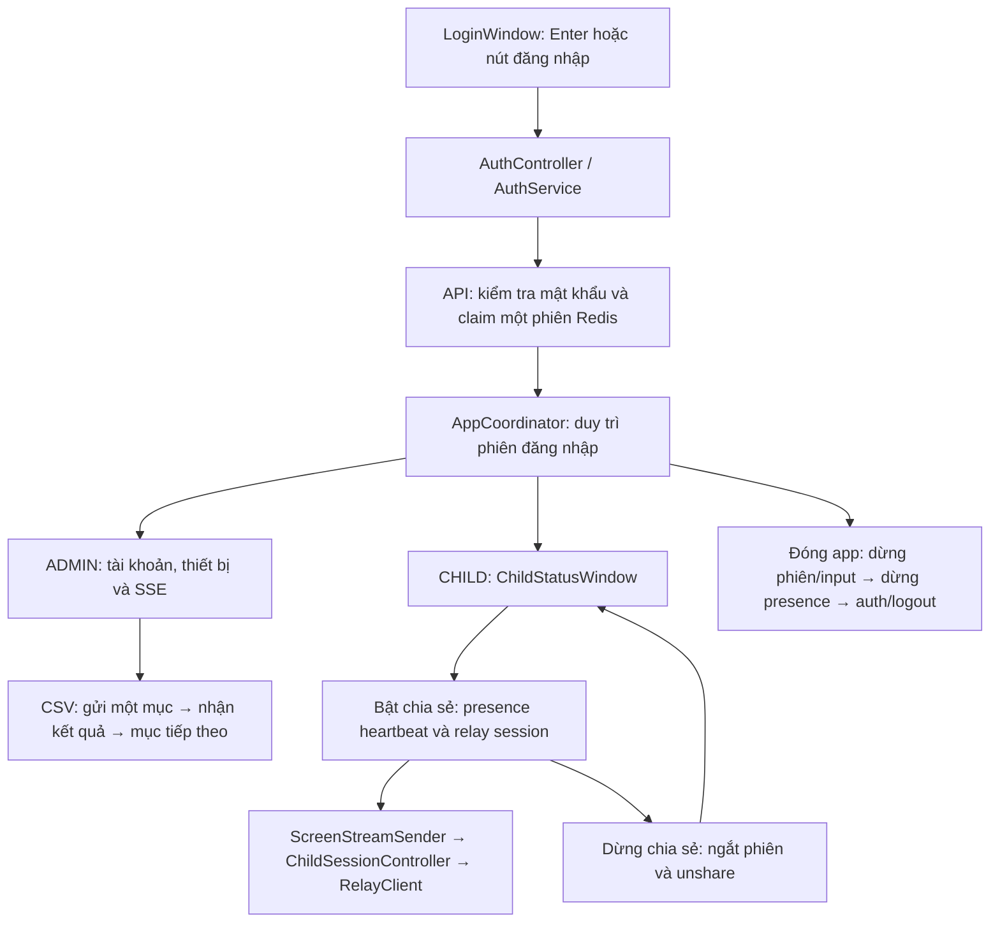

# Rà soát độ gọn và workflow — 2026-11-16

## Phạm vi và nguyên tắc

Rà các luồng khởi động/đăng nhập, ADMIN và CHILD, chia sẻ/hiện diện, quản lý tài khoản/CSV/cài đặt, gửi ảnh/input, SSE/REST, phân phối relay và dọn phiên. Mốc trước refactor: `9f99b25`. Giữ hành vi, giao thức, chính sách một nơi đăng nhập và theme QSS; không thêm framework hoặc một tầng repository/factory chung chỉ để bọc lời gọi.

## Những chỗ đã sửa

| Vấn đề trước | Thay đổi | Tác dụng |
| --- | --- | --- |
| `AppCoordinator::handleLoginSuccess` dài 145 dòng, vừa phân vai vừa tạo layout, đổi text và kết nối transport | Còn 22 dòng điều phối; tách `createAdminWorkspace`, `createChildWorkspace`; đưa phần trình bày vào `ChildStatusWindow` | Khi đọc workflow không phải lần qua layout; GUI không phụ thuộc network, controller quyết định lifecycle |
| Dọn QObject con bằng nhiều `deleteLater` dù đã có parent; injector dùng `new` và lambda xóa riêng | Để QObject parent quản lý con; giữ dọn các cửa sổ top-level; injector sống cùng các callback bằng `shared_ptr` | Giảm hai cách quản lý cùng một lifetime; vẫn dừng input/relay trước logout |
| Import CSV giữ cả queue lẫn bộ đếm số mục còn lại, callback lồng nhiều nhánh | Queue quyết định còn mục; một cờ phân biệt import với tạo lẻ, xử lý bằng các nhánh return sớm | Bỏ trạng thái trùng cần đồng bộ; tiếp tục gửi tuần tự, chỉ refresh khi hoàn tất, giữ thống kê thành công/thất bại |
| ADMIN và CHILD lặp claim, UUID, token và response trong hai nhánh | Một `openLogin` chung; kiểm tra mật khẩu và mở binding CHILD vẫn rõ ràng | Tránh sửa quy tắc phiên ở hai chỗ; giữ rollback khi ghi binding thất bại |
| Kiểm tra phiên CHILD đọc credential/lease ở AuthService rồi lại làm trong PresenceService | AuthService dùng kiểm tra binding + credential + lease đã có ở PresenceService | Bớt một lần tìm tài khoản trong DB và một lần kiểm tra Redis cho mỗi lần interceptor xác thực CHILD hợp lệ; không bỏ xác thực |
| Lớp chụp ảnh giữ trực tiếp RelayClient và gửi raw packet dù đã có ChildSessionController | ScreenStreamSender dùng `pendingBytes`/`sendScreenPacket` của phiên | Chỉ lớp phiên quản lý transport; packet sinh ra vẫn qua kiểm tra session/giới hạn trước khi gửi |

Không coi việc tổng số dòng giảm là mục tiêu: view mới có phần khai báo riêng. Kết quả chính là loại bỏ trạng thái lặp, một đường gửi bypass lớp phiên và logic tạo token trùng; hàm điều phối chỉ còn các bước có tên.

## Workflow hiện tại

| Luồng đã rà | Quyết định |
| --- | --- |
| Login và shutdown | Tách dựng workspace khỏi login, giữ thứ tự dừng phiên trước nhả lease; không khởi chạy sharing khi chỉ mới login |
| Thiết bị | Giữ một store, SSE cho cập nhật và REST cho refresh/phản hồi lỗi; không thêm polling liên tục hay cache thứ hai |
| CRUD và CSV | Giữ controller/service/store với trách nhiệm cụ thể; import tuần tự và gom refresh cuối, kể cả trường hợp lỗi một phần |
| Cài đặt | Giữ validation và chặn gửi đổi mật khẩu lặp; không thêm bảng cấu hình relay/API vào UI |
| Ảnh và input | Giữ capture/encode/packetize và decode/reassemble riêng; gửi qua lớp phiên; giữ giới hạn frame, backpressure và hàng chờ decode |
| Relay và failover | Giữ state machine PENDING/ACTIVE, generation fence, timeout và retry có backoff; đây là trạng thái bất đồng bộ cần thiết, không phải code thừa |
| Auth và presence | Giữ hai heartbeat vì tắt sharing vẫn phải giữ login; giữ lease Redis nguyên tử và thời gian drain để quyền relay cũ hết hiệu lực trước phục hồi sau crash |

Không thay đổi phối màu, QSS, objectName, role của nút/label hoặc chữ hiển thị CHILD. Không đổi DB schema, wire protocol, thời hạn lease hoặc chính sách unattended.

## Bằng chứng kiểm tra sau thay đổi

- Build desktop thành công; toàn bộ 8 nhóm CTest đạt. AccountDeviceFlowTest có 21 case đạt, gồm các case cũ và case mới `csvPartialFailureCanBeFollowedByManualCreate` xác nhận thống kê lỗi, dialog còn mở, tạo lẻ tiếp được và mỗi lượt chỉ refresh một lần.
- Maven server: 26 test API và 31 test relay đạt, không sửa các kỳ vọng test cũ để phù hợp refactor. 5 test Redis IT đạt riêng.
- Hai API thật dùng cùng PostgreSQL/Redis disposable: `single_login_acceptance.py` đạt cả race 16 login mỗi vai trò, token cũ bị chặn, unshare giữ login, logout và thời hạn crash 60 + 30 giây theo đồng hồ thật.
- `SingleLoginDesktopAcceptance` chạy Qt offscreen với API thật đạt cả ADMIN/CHILD: Enter, từ chối login thứ hai, gia hạn khi chưa sharing và nhả phiên khi đóng.
- `account_management_acceptance.py` đạt CRUD, rename, reset/thu hồi token, owner isolation và quota đồng thời.
- Chạy hai tiến trình `DesktopRelayAcceptance` với Java relay thật và authorizer benchmark loopback; CHILD trên Xvfb riêng, ADMIN offscreen: capture/JPEG, click và gõ phím native, giữ stream và ngắt phiên đạt. Trong 5.000 ms giữ stream nhận 24 frame, gap lớn nhất 212 ms. Đây là kiểm tra hồi quy trên một host, không phải benchmark Internet/hai VM hay chứng minh CPU/RAM giảm.
- Không dừng/chỉnh VM, API, Redis hoặc DB đang dùng của người dùng. Xvfb được giải nén vào thư mục test riêng, không cài lên hệ thống; stack DB/API test được dọn sau chạy.

Các log đợt này: `/tmp/pbl4-review-ctest.log`, `/tmp/pbl4-simplify-server-tests.log`, `/tmp/pbl4-review-redis-tests.log`, `/tmp/pbl4-review-login-acceptance.log`, `/tmp/pbl4-review-desktop-acceptance.log`, `/tmp/pbl4-review-account-acceptance.log`, `/tmp/pbl4-simplify-stream-acceptance.log`.
